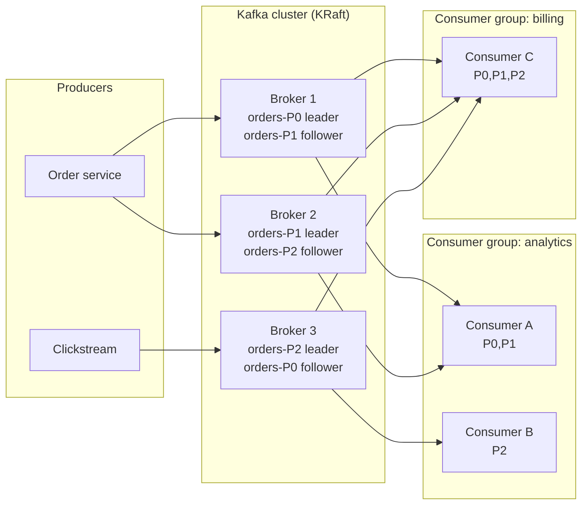
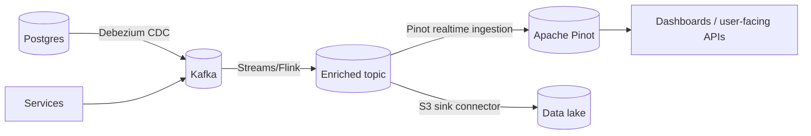

# 01 — Apache Kafka: Theory, Concepts and Code

> Goal: after this chapter you can explain Kafka's architecture on a whiteboard, write producers/consumers correctly, and reason about delivery guarantees, ordering and scaling.
> Runnable code lives in [`examples/kafka/`](../examples/kafka). Start the stack from [03-installation.md](03-installation.md) first.

## Contents
1. [What Kafka is (and is not)](#1-what-kafka-is-and-is-not)
2. [Core vocabulary](#2-core-vocabulary)
3. [Architecture](#3-architecture)
4. [Partitions, keys and ordering](#4-partitions-keys-and-ordering)
5. [Replication, ISR and durability](#5-replication-isr-and-durability)
6. [Producers](#6-producers)
7. [Consumers and consumer groups](#7-consumers-and-consumer-groups)
8. [Delivery semantics and exactly-once](#8-delivery-semantics-and-exactly-once)
9. [Storage: retention and log compaction](#9-storage-retention-and-log-compaction)
10. [Ecosystem: Connect, Streams, Schema Registry](#10-ecosystem)
11. [Serialization and schema evolution](#11-serialization-and-schema-evolution)
12. [Security](#12-security)
13. [Monitoring and operations](#13-monitoring-and-operations)
14. [Design patterns and anti-patterns](#14-design-patterns-and-anti-patterns)
15. [Cheat-sheet: CLI commands](#15-cli-cheat-sheet)

---

## 1. What Kafka is (and is not)

Kafka is a **distributed, partitioned, replicated, append-only commit log**. Producers append records, consumers read them at their own pace by tracking an **offset**. Records are *not* deleted when consumed; they are deleted by retention policy (time/size) or compacted by key.

| Use it for | Don't use it for |
|---|---|
| Event streaming / event-driven microservices | Request/response RPC |
| Ingestion buffer between systems (decoupling, back-pressure) | Random-access storage / ad-hoc queries (use Pinot, a DB) |
| CDC, log aggregation, metrics, clickstream | Tiny-volume task queues needing per-message ack/priorities (RabbitMQ/SQS fit better) |
| Source of truth for stream processing (Flink, Kafka Streams, Spark) | Large blobs (> a few MB per message) |

**Why it is fast**: sequential disk I/O, OS page cache, zero-copy (`sendfile`) from page cache to socket, batching, compression, and horizontal partitioning.

## 2. Core vocabulary

| Term | Meaning |
|---|---|
| **Record / message** | key (optional), value, headers, timestamp. |
| **Topic** | Named stream of records (logical). |
| **Partition** | Ordered, immutable sequence of records inside a topic; unit of parallelism, ordering and replication. |
| **Offset** | Sequential id of a record *within a partition*. Ordering is guaranteed only within one partition. |
| **Broker** | Kafka server. A cluster has many. |
| **Leader / follower** | Each partition has 1 leader (serves reads+writes) and N-1 followers (replicate). |
| **ISR** | In-Sync Replicas: followers caught up with the leader. |
| **Producer** | Client appending records. |
| **Consumer / consumer group** | Clients reading records; members of a group split the partitions among them. |
| **Controller** | The broker (KRaft quorum) managing metadata, leader election. |
| **Segment** | A partition is stored as many segment files (`.log`, `.index`, `.timeindex`). Retention deletes whole segments. |

## 3. Architecture



* **KRaft mode** (Kafka ≥ 3.3 production-ready, ZooKeeper removed in 4.0): metadata is stored in an internal Raft-replicated log (`__cluster_metadata`) managed by *controller* nodes. Faster failover, simpler ops, millions of partitions.
* Different consumer **groups** are independent: each gets every record (pub/sub). Inside one group each partition is read by exactly one member (queue semantics).

## 4. Partitions, keys and ordering

* Default partitioner: `partition = murmur2(key) % numPartitions`. No key → sticky batches spread across partitions.
* **Same key → same partition → total order for that key.** That is why the project keys by `order_id`.
* **Ordering is NOT guaranteed across partitions.**
* Max consumer parallelism in a group = number of partitions. Extra consumers sit idle.
* **Changing partition count** (can only increase) changes `key → partition` mapping for new data → breaks per-key ordering/colocation across the change (and breaks Pinot upsert partitioning assumptions). Size partitions up front (e.g. target throughput ÷ per-partition throughput ≈ 10 MB/s write per partition as a start, then multiply by headroom).
* Hot keys → hot partitions (skew). Mitigate with salting or better keys.

## 5. Replication, ISR and durability

```text
replication.factor = 3, min.insync.replicas = 2, producer acks = all
```
* Write succeeds only when the leader + enough followers (≥ `min.insync.replicas`) have it. Tolerates 1 broker failure without data loss **and** without losing availability.
* If ISR < `min.insync.replicas` → producers with `acks=all` get `NotEnoughReplicas` (choose consistency over availability).
* `unclean.leader.election.enable=false` (default) — never elect an out-of-sync replica (avoids data loss, may reduce availability).
* **High watermark**: consumers only see records replicated to all ISR members.
* `acks`: `0` fire-and-forget, `1` leader only (can lose data on leader crash), `all` safest.

## 6. Producers

Flow: `send()` → serializer → partitioner → per-partition **batch** in the accumulator → background sender thread → broker.

Key settings:

| Setting | Why it matters |
|---|---|
| `acks=all` | Durability. |
| `enable.idempotence=true` | Producer id + sequence numbers: retries never create duplicates or reorder within a partition (default true in Kafka clients ≥ 3.0). |
| `linger.ms`, `batch.size` | Larger batches → higher throughput, a little more latency. |
| `compression.type` | `lz4`/`zstd` cut network & disk. |
| `delivery.timeout.ms` | Upper bound for send incl. retries. |
| `max.in.flight.requests.per.connection ≤ 5` | Keeps ordering with idempotence. |

Python (confluent-kafka) — see [`01_producer.py`](../examples/kafka/01_producer.py):

```python
from confluent_kafka import Producer
p = Producer({"bootstrap.servers": "localhost:29092", "acks": "all", "enable.idempotence": True})
p.produce("demo.events", key="order-1", value=b'{"x":1}', on_delivery=lambda err, m: print(err or m.offset()))
p.flush()
```

Java equivalent:

```java
Properties props = new Properties();
props.put("bootstrap.servers", "localhost:29092");
props.put("key.serializer", StringSerializer.class.getName());
props.put("value.serializer", StringSerializer.class.getName());
props.put("acks", "all");
props.put("enable.idempotence", "true");
try (KafkaProducer<String, String> p = new KafkaProducer<>(props)) {
    p.send(new ProducerRecord<>("demo.events", "order-1", "{\"x\":1}"),
           (meta, ex) -> { if (ex != null) ex.printStackTrace(); else System.out.println(meta.offset()); });
}
```

## 7. Consumers and consumer groups

* Consumers **pull** (`poll`). They commit the *next* offset to read into the internal topic `__consumer_offsets`.
* **Group coordinator** (a broker) tracks membership via heartbeats. Member joins/leaves/crashes → **rebalance** (partition reassignment).
* Assignment strategies: `range`, `roundrobin`, `sticky`, **`cooperative-sticky`** (incremental rebalance — avoids stop-the-world; preferred).
* **Static membership** (`group.instance.id`) avoids rebalances on quick restarts.
* `auto.offset.reset` (`earliest|latest`) applies only when no committed offset exists (or it's out of range).
* **Lag** = log-end-offset − committed offset; the #1 health metric for consumers.

Commit strategies:

| Strategy | Behaviour |
|---|---|
| Auto-commit (`enable.auto.commit=true`) | Periodic; can lose or duplicate on crash. Fine only for lossy workloads. |
| Manual sync after processing | **At-least-once** (project processor). |
| Manual commit before processing | **At-most-once**. |
| Offsets in same transaction as output | **Exactly-once** (Kafka→Kafka). |

Important timeouts: `session.timeout.ms` (heartbeat loss → evicted), `max.poll.interval.ms` (time between polls — slow processing → evicted → rebalance storm), `max.poll.records`/`fetch.min.bytes`/`fetch.max.wait.ms` (throughput tuning).

See [`02_consumer_group.py`](../examples/kafka/02_consumer_group.py) — start two copies and watch the `assigned/revoked` logs.

## 8. Delivery semantics and exactly-once

| Semantics | How |
|---|---|
| At-most-once | Commit first, then process. |
| At-least-once | Process, then commit (default thinking). Make consumers **idempotent**. |
| Exactly-once (EOS) | Idempotent producer + **transactions** (`transactional.id`) + consumers with `isolation.level=read_committed`. Atomically writes output records and consumer offsets. Kafka Streams: `processing.guarantee=exactly_once_v2`. |

Caveats:
* EOS only covers **Kafka → Kafka**. Writing to an external DB needs idempotent writes/upserts or the transactional outbox pattern.
* Zombie fencing: a new producer with the same `transactional.id` bumps the epoch and fences older instances.
* In this project, end-to-end "effectively-once" comes from *at-least-once + Pinot upsert idempotency*.

Code: [`03_transactions.py`](../examples/kafka/03_transactions.py).

## 9. Storage: retention and log compaction

* **Delete policy** (`cleanup.policy=delete`): drop segments older than `retention.ms` or beyond `retention.bytes`.
* **Compaction** (`cleanup.policy=compact`): keep only the latest record per key; a record with a `null` value (**tombstone**) deletes the key after `delete.retention.ms`. Used for changelogs, KTables, reference data (e.g. product catalog), `__consumer_offsets`.
* Segment roll: `segment.bytes`/`segment.ms`. Active segment is never deleted/compacted.
* **Tiered storage** (KIP-405) offloads old segments to object storage.

## 10. Ecosystem

| Component | Purpose |
|---|---|
| **Kafka Connect** | Config-only source/sink connectors (Debezium CDC, JDBC, S3, Elasticsearch, Snowflake …); distributed, scalable, offset tracking, SMTs. |
| **Kafka Streams** | Java library for stateful stream processing (KStream/KTable, windows, joins, state stores backed by changelog topics). |
| **ksqlDB** | SQL over streams. |
| **Flink / Spark Structured Streaming** | Heavier stream processing engines. |
| **Schema Registry** | Stores Avro/Protobuf/JSON schemas, enforces compatibility. |
| **MirrorMaker 2** | Cross-cluster replication / DR. |



## 11. Serialization and schema evolution

* JSON: easy, verbose, no contract. Avro/Protobuf: compact, schema-enforced, evolvable.
* Schema Registry stores schemas; messages carry a 5-byte header (magic byte + schema id).
* Compatibility modes: `BACKWARD` (default; new schema reads old data → add optional fields/remove fields), `FORWARD`, `FULL`, `*_TRANSITIVE`, `NONE`.
* Rule of thumb: only **add fields with defaults**; never rename/retype; use a new topic for breaking changes.
* Poison pills → **dead-letter topic** (this project: `orders.dlq`).

## 12. Security

* **Encryption**: TLS between clients↔brokers and brokers↔brokers.
* **Authentication**: SASL (`SCRAM-SHA-512`, `OAUTHBEARER`, GSSAPI/Kerberos) or mTLS.
* **Authorization**: ACLs (`kafka-acls.sh`) per principal/resource/operation; least privilege (producer: `WRITE`,`DESCRIBE`; consumer: `READ` on topic + group).
* Never put secrets in code; read credentials from env/secret manager. The local stack is `PLAINTEXT` for learning only.

## 13. Monitoring and operations

Metrics (JMX → Prometheus → Grafana, or Cruise Control / Burrow / Kafka UI):

| Metric | Alert when |
|---|---|
| Consumer **lag** per group/partition | Growing steadily |
| `UnderReplicatedPartitions` | > 0 for minutes |
| `OfflinePartitionsCount` | > 0 (page!) |
| `ActiveControllerCount` | ≠ 1 |
| Request latency p99 (produce/fetch), `RequestHandlerAvgIdlePercent` | < 20-30% idle |
| Disk usage, network saturation | > 70-80% |
| ISR shrink/expand rate | Flapping |

Ops tasks: rolling upgrades (one broker at a time, check URP = 0), partition reassignment (`kafka-reassign-partitions.sh`, Cruise Control), preferred-leader election, quotas to protect the cluster from noisy clients.

Sizing sanity: `storage = ingress MB/s × retention seconds × replication factor × (1 + overhead)`.

## 14. Design patterns and anti-patterns

**Patterns**: event sourcing, CQRS, transactional outbox, CDC with Debezium, dead-letter queue + retry topics, idempotent consumer (dedupe by event id), claim-check for large payloads, saga/choreography, compacted topic as shared reference data.

**Anti-patterns**: one giant topic for everything; too many tiny partitions (cost: file handles, metadata, rebalance time); auto-commit with slow processing; unbounded retries without DLQ (blocks partition); consuming + doing slow blocking I/O inside `poll` loop (rebalance storms); relying on cross-partition order; changing partition counts casually; `auto.create.topics.enable=true` in prod.

## 15. CLI cheat-sheet

Run inside the container: `docker exec -it kafka bash` (scripts in `/opt/kafka/bin`).

```bash
# topics
kafka-topics.sh --bootstrap-server kafka:9092 --list
kafka-topics.sh --bootstrap-server kafka:9092 --describe --topic orders.raw
kafka-topics.sh --bootstrap-server kafka:9092 --alter --topic orders.raw --partitions 12     # increase only
kafka-configs.sh --bootstrap-server kafka:9092 --entity-type topics --entity-name orders.raw --alter --add-config retention.ms=86400000

# produce / consume
kafka-console-producer.sh --bootstrap-server kafka:9092 --topic demo.events --property parse.key=true --property key.separator=:
kafka-console-consumer.sh --bootstrap-server kafka:9092 --topic orders.enriched --from-beginning --max-messages 5 --property print.key=true

# consumer groups and lag
kafka-consumer-groups.sh --bootstrap-server kafka:9092 --list
kafka-consumer-groups.sh --bootstrap-server kafka:9092 --describe --group orders-processor
kafka-consumer-groups.sh --bootstrap-server kafka:9092 --group orders-processor --topic orders.raw --reset-offsets --to-earliest --dry-run   # --execute to apply (group must be stopped)

# misc
kafka-get-offsets.sh --bootstrap-server kafka:9092 --topic orders.raw
kafka-log-dirs.sh --bootstrap-server kafka:9092 --describe
```

---
Next: [02 — Apache Pinot](02-pinot.md)
