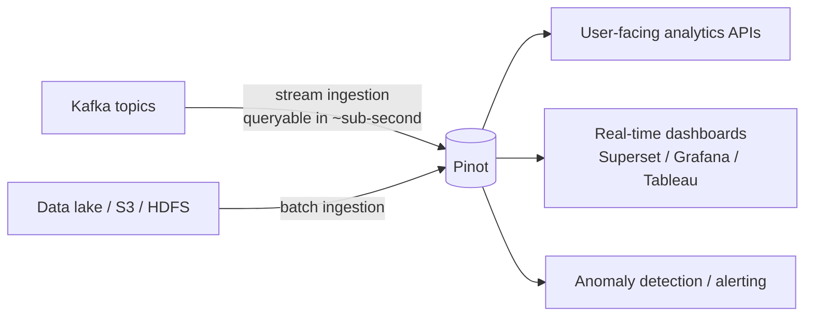
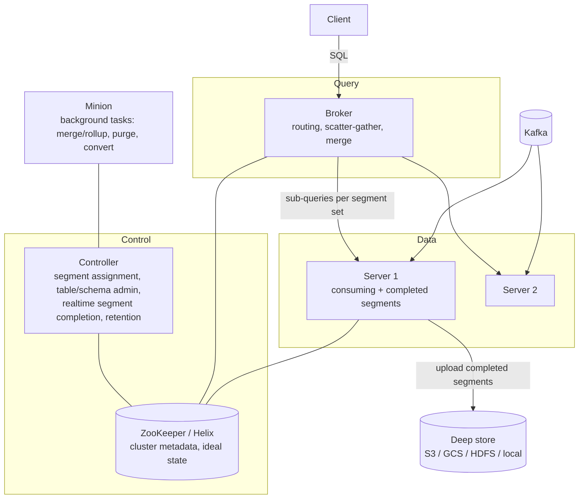
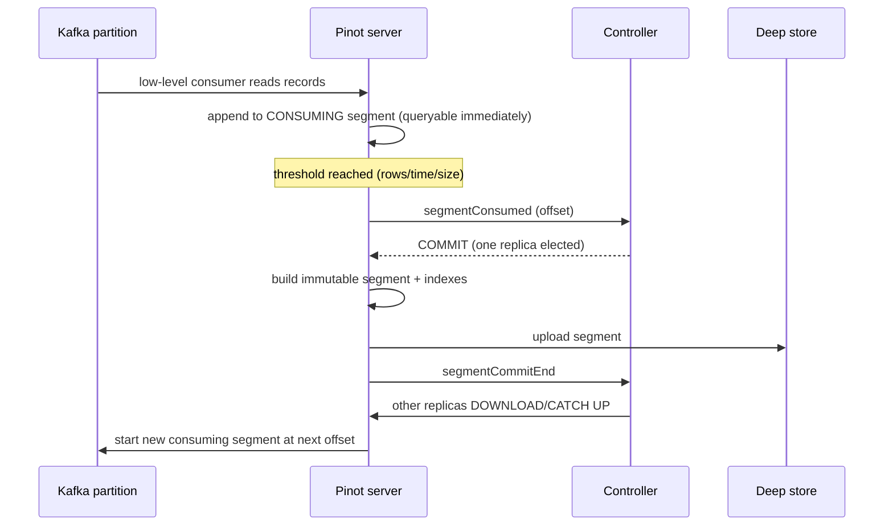

# 02 — Apache Pinot: Theory, Concepts and Code

> Pinot is a **real-time distributed OLAP datastore** built for **low-latency (ms) analytical queries at high concurrency (thousands of QPS)** over **fresh** data — including *user-facing* analytics (LinkedIn "Who viewed your profile", Uber Eats restaurant dashboards, Stripe, Walmart, etc.).
> Runnable code: [`examples/pinot/`](../examples/pinot) and the [project](04-project.md).

## Contents
1. [Where Pinot fits](#1-where-pinot-fits)
2. [Architecture](#2-architecture)
3. [Data model: schema and table](#3-data-model-schema-and-table)
4. [Segments](#4-segments)
5. [Real-time ingestion from Kafka](#5-real-time-ingestion-from-kafka)
6. [Batch ingestion and hybrid tables](#6-batch-ingestion-and-hybrid-tables)
7. [Indexes (the performance toolbox)](#7-indexes)
8. [Upsert and dedup](#8-upsert-and-dedup)
9. [Query engines: v1 (single-stage) and v2 (multi-stage)](#9-query-engines)
10. [Routing, replica groups, tenants](#10-routing-replica-groups-tenants)
11. [Retention, minion tasks, tiered storage](#11-retention-minion-and-tiers)
12. [Performance tuning playbook](#12-performance-tuning-playbook)
13. [REST API cheat-sheet](#13-rest-api-cheat-sheet)
14. [Pinot vs. other systems](#14-pinot-vs-other-systems)
15. [Limitations / gotchas](#15-limitations--gotchas)

---

## 1. Where Pinot fits



| Need | Good fit? |
|---|---|
| Aggregations/group-by/filters on billions of rows in < 100 ms | ✅ |
| Thousands of concurrent queries (app-facing) | ✅ |
| Data queryable within seconds of arriving in Kafka | ✅ |
| Heavy multi-way joins, ad-hoc ETL-style SQL | ⚠️ multi-stage engine helps; Trino/Spark/Snowflake still better for big joins |
| OLTP (row-level transactions, frequent updates/deletes) | ❌ (use Postgres etc.; Pinot has *upsert* for latest-state only) |

## 2. Architecture



| Component | Responsibility |
|---|---|
| **Controller** (Helix controller + REST/UI on :9000) | Owns cluster metadata in ZooKeeper; creates tables/schemas; assigns segments to servers; coordinates real-time segment commit; runs periodic tasks (retention, validation, rebalance). |
| **Broker** (:8099) | Receives SQL, prunes segments, picks servers (routing table), scatters sub-queries, merges partial results, returns response. Stateless. |
| **Server** | Hosts segments, executes query on its segments; **consuming** servers ingest from the stream into in-memory mutable segments; completed segments are immutable & columnar. |
| **Minion** (optional) | Offloaded background tasks: `MergeRollupTask`, `RealtimeToOfflineSegmentsTask`, `PurgeTask`, `SegmentGenerationAndPushTask`. |
| **ZooKeeper** | Coordination store used by Apache Helix. |
| **Deep store** | Durable copy of completed segments (S3/GCS/ADLS/HDFS/NFS) — used for recovery and server bootstrap. |
| **Tenants** | Tag-based isolation: group brokers/servers (e.g. `DefaultTenant`, `premium`) and assign tables to them. |

### Query path (read)
1. Client → **Broker** (SQL).
2. Broker parses, plans, prunes segments (time range, partition, bloom) and uses the **routing table** to choose one replica per segment.
3. **Servers** execute plan per segment (index lookups → filter → project → aggregate) in parallel, return partial results.
4. Broker **merges** (final aggregation, order-by, limit) and returns the result + stats (`numDocsScanned`, `timeUsedMs`, …).

## 3. Data model: schema and table

Pinot separates **Schema** (columns) from **Table config** (how to ingest/index/place data). A table name + type form the physical table: `orders_REALTIME`, `orders_OFFLINE`.

Column roles in a schema:

| Field spec | Use |
|---|---|
| `dimensionFieldSpecs` | Attributes to filter/group by (strings, ids, categorical). Supports multi-value (`"singleValueField": false`). |
| `metricFieldSpecs` | Numeric measures to aggregate (SUM/AVG). |
| `dateTimeFieldSpecs` | Time columns with `format` (e.g. `1:MILLISECONDS:EPOCH`) & `granularity`. Needed for retention, time pruning, hybrid tables. |
| `primaryKeyColumns` | Required for upsert/dedup. |

Data types: `INT, LONG, FLOAT, DOUBLE, BIG_DECIMAL, BOOLEAN, TIMESTAMP, STRING, JSON, BYTES`, and maps/arrays via multi-value & JSON.

Minimal schema + realtime table (annotated):

```jsonc
// schema
{ "schemaName": "page_views",
  "dimensionFieldSpecs": [{"name":"user_id","dataType":"STRING"},{"name":"url","dataType":"STRING"}],
  "metricFieldSpecs":    [{"name":"duration_ms","dataType":"LONG"}],
  "dateTimeFieldSpecs":  [{"name":"ts","dataType":"LONG","format":"1:MILLISECONDS:EPOCH","granularity":"1:MILLISECONDS"}] }

// table
{ "tableName": "page_views", "tableType": "REALTIME",
  "segmentsConfig": {"timeColumnName":"ts","schemaName":"page_views","replication":"1","retentionTimeUnit":"DAYS","retentionTimeValue":"30"},
  "tenants": {},
  "tableIndexConfig": {"invertedIndexColumns":["url"]},
  "ingestionConfig": {"streamIngestionConfig": {"streamConfigMaps": [ { "streamType":"kafka", "stream.kafka.topic.name":"page_views", "...": "..." } ]}} }
```

Ingestion-time transforms (`ingestionConfig.transformConfigs`) can derive columns (Groovy or built-in functions such as `jsonPathString`, `toDateTime`, `fromEpochSeconds`), and `filterConfig` can drop rows.

## 4. Segments

A table is horizontally partitioned into **segments** — self-contained, immutable (once completed), **columnar** files with dictionaries, forward indexes, and the other indexes. A segment is the unit of **assignment, replication, pruning, and query parallelism**.

Types for real-time tables:
* **CONSUMING segment** — mutable, in-memory (on-heap/off-heap), being filled from a Kafka partition. Already queryable.
* **COMPLETED (committed) segment** — flushed when a threshold is hit (`flush.threshold.rows` / `.time` / `.segment.size`), converted to immutable columnar format, uploaded to deep store, replicated. A new consuming segment starts at the next offset.

Segment naming: `table__<partitionId>__<sequence>__<creationTime>`.

Why small number of right-sized segments matters: too many tiny segments → high per-query overhead and ZK metadata; too big → slow recovery & less parallelism. Target roughly **100–500 MB (or 1–10 M rows)**; use `realtime.segment.flush.threshold.rows=0` + `segment.size=...` for auto-tuning.

## 5. Real-time ingestion from Kafka



* **Low-level consumer** (one consuming segment per Kafka partition per replica) — the default. Each replica consumes independently, offsets are stored in segment metadata in ZK, *not* in Kafka consumer groups.
* Number of Kafka partitions ≈ upper bound on ingestion parallelism per table (can be raised by consuming fewer partitions per server → add servers).
* Decoders: `KafkaJSONMessageDecoder`, Avro (`KafkaAvroMessageDecoder` / Confluent), Protobuf, Thrift, CSV, custom.
* `auto.offset.reset`: `smallest` (backfill from earliest) / `largest`.
* **Data freshness** = Kafka end-to-end latency + consumption (typ. < 1 s).
* Pause/resume consumption via REST (`/tables/{t}/pauseConsumption`), force commit (`/tables/{t}/forceCommit`), reload segments after index change (`/segments/{t}/reload`).
* Pinot can also ingest from Kinesis and Pulsar, and one table can consume several topics via multiple entries in `streamConfigMaps`.

## 6. Batch ingestion and hybrid tables

* **Offline table**: segments built by Spark/Hadoop/standalone `LaunchDataIngestionJob` from files (Parquet, Avro, CSV, JSON) in S3/HDFS, then pushed.
* **Hybrid table** = `X_REALTIME` + `X_OFFLINE` with the same name & schema. Broker splits query at a **time boundary** (max time of offline data): offline serves old data, realtime serves recent. Typical flow: real-time for freshness, nightly offline segments (cleaned/compacted/back-filled) replace it; `RealtimeToOfflineSegmentsTask` (Minion) automates this.
* Backfill/corrections are done by pushing replacement segments with the same names.

## 7. Indexes

Choose indexes based on **query patterns**; every index costs storage and ingestion CPU.

| Index | Best for | Notes |
|---|---|---|
| **Forward index** | Always present; dictionary-encoded (default) or raw (`noDictionaryColumns`) | Raw for high-cardinality metrics / large JSON/text. |
| **Dictionary** | Low/med cardinality | Faster filtering; disable for high-cardinality. |
| **Sorted index** | Column the segment is physically sorted by (`sortedColumn`) | Cheapest filter; one per table (realtime sort via `sortedColumn` applied at segment completion). |
| **Inverted index** | Equality / IN filters on dimensions | Most common. |
| **Range index** | `>`, `<`, `BETWEEN` on numerics/timestamps | |
| **Bloom filter** | Point lookups on high-cardinality (ids) — prunes whole segments | Great with `order_id = '...'`. |
| **Star-tree index** | Pre-aggregated cube for fixed *aggregation* query shapes (`SUM/COUNT/MIN/MAX/DISTINCTCOUNTHLL` + group-by on set dimensions) | Bounds work by `maxLeafRecords` → predictable low latency (10–100× speed-up); only on completed segments; query must use only the configured dims/functions. |
| **Text index** (Lucene) / **FST/IFST** | Full-text, regex, prefix | `TEXT_MATCH(col,'expr')`. |
| **JSON index** | Filtering on nested JSON (`JSON_MATCH`) | |
| **Geospatial (H3)** | `ST_Distance`, radius queries | |
| **Timestamp index** | Time-granularity bucketing (`DATETRUNC`) | |
| **Vector index** | Similarity search (newer versions) | |
| **Partitioning** (`segmentPartitionConfig`) | Segment pruning for `WHERE key = x` + co-located joins | Must match Kafka partitioning function (Murmur). |

Star-tree example (used in this project's `order_events` table):

```json
"starTreeIndexConfigs": [{
  "dimensionsSplitOrder": ["status","category","city","payment_method"],
  "functionColumnPairs": ["COUNT__*","SUM__amount","SUM__quantity"],
  "maxLeafRecords": 10000
}]
```
It accelerates e.g. `SELECT category, SUM(amount) FROM order_events WHERE status='PAID' GROUP BY category` — verify by checking `numDocsScanned` drops dramatically.

## 8. Upsert and dedup

Real-time tables are append-only by default. **Upsert** keeps the **latest row per primary key** (e.g. order status, driver location, user profile).

```json
// schema:  "primaryKeyColumns": ["order_id"]
// table:
"upsertConfig": { "mode": "FULL", "comparisonColumns": ["event_time"] },
"routing":      { "instanceSelectorType": "strictReplicaGroup" }
```

How it works: each server keeps an in-memory map `primaryKey → (segment, docId, comparisonValue)` and a **valid-doc-ids bitmap** per segment. Queries are automatically filtered by the bitmap. A new record with a comparison value ≥ the existing one marks the old doc invalid.

**Hard requirements**
1. Kafka topic **must be partitioned by the primary key** (so all versions of a key reach the same Pinot server/partition) → we key Kafka messages by `order_id`.
2. `strictReplicaGroup` routing so the same replica group serves all segments of a partition (consistent view).
3. Memory: primary-key map lives on heap/off-heap → plan capacity (`#keys × ~(key size + ~50 B)`); use hash functions (`hashFunction: MD5/MURMUR3`) to shrink long keys.

Modes: `FULL` (replace whole row), `PARTIAL` (per-column merge strategies: `OVERWRITE, INCREMENT, APPEND, UNION, MAX, MIN, IGNORE`). Options: `deleteRecordColumn` (soft deletes), `metadataTTL`/`deletedKeysTTL`, `snapshot`/`preload` for faster restarts, `outOfOrderRecordColumn`, `dropOutOfOrderRecord`.

**Dedup** (`dedupConfig: {dedupEnabled: true}`) — first record wins, later duplicates ignored (idempotent ingestion of at-least-once streams) — also needs primary keys & key-partitioned topic.

## 9. Query engines

| | v1 / Single-stage (SSE) | v2 / Multi-stage (MSE) |
|---|---|---|
| Strength | Ultra-low latency filter/aggregate/group-by on **one table** | Joins, window functions, sub-queries, set ops, `UNION/INTERSECT`, semi-joins |
| Execution | Broker scatter → servers → broker merge | Query planner (Calcite) → stages exchanged between servers/workers (shuffle) |
| Enable | default | `SET useMultistageEngine = true;` (default in newer releases) or `queryOptions=useMultistageEngine=true` |

Useful SQL features: `GROUP BY`/`HAVING`/`ORDER BY`/`LIMIT` (default limit is **10** if omitted!), `CASE`, `DATETRUNC`, `DATETIMECONVERT`, `ago()`, `FILTER (WHERE ...)`, `DISTINCTCOUNTHLL`, `PERCENTILETDIGEST`, `JSON_EXTRACT_SCALAR`, `TEXT_MATCH`, `ST_*`, `LOOKUP` (dimension-table lookups), `EXPLAIN PLAN FOR`, `SET` options (`timeoutMs`, `skipUpsert`, `useStarTree`, `enableNullHandling`).

Examples → [`examples/pinot/queries.sql`](../examples/pinot/queries.sql).

**Dimension tables** (`isDimTable: true`, offline, replicated on every server) enable broadcast joins / `LOOKUP()` for small reference data.

## 10. Routing, replica groups, tenants

* **Balanced** routing (default) spreads segments across all servers.
* **Replica-group** routing: all segments of a table are covered by each replica group — a query touches only one group's servers → fewer servers per query → *higher QPS*. Add more groups to scale QPS, add servers per group to scale data.
* **Partition-aware** routing + `segmentPartitionConfig` → queries with `WHERE key = X` hit one partition.
* **Tenants** isolate workloads; **tag-based** server pools; separate **COMPLETED** vs **CONSUMING** instance assignment for hot/cold tiers.
* Rebalance after scaling: `POST /tables/{t}/rebalance?reassignInstances=true&type=REALTIME`.

## 11. Retention, Minion and tiers

* `retentionTimeUnit/Value` — controller deletes segments older than N (based on time column).
* **Minion tasks**: `MergeRollupTask` (merge small segments, roll-up to coarser time buckets), `RealtimeToOfflineSegmentsTask`, `PurgeTask` (GDPR deletes), `UpsertCompactionTask`, `SegmentRefreshTask`.
* **Tiered storage**: move older segments to cheaper servers (`tierConfigs`) by age.

## 12. Performance tuning playbook

1. **Look at the stats** in every response: `numEntriesScannedInFilter` (≈ filter cost, bad if huge → add index), `numEntriesScannedPostFilter`, `numDocsScanned`, `numSegmentsQueried/Matched/Processed`, `timeUsedMs`.
2. Add **inverted** index on filter columns, **range** on numeric ranges, **bloom** on id lookups, **sorted** column for the most common filter, **star-tree** for dashboard aggregations.
3. Keep time column filters on every query (enables segment pruning).
4. Prefer `DISTINCTCOUNTHLL`/`PERCENTILETDIGEST` to exact variants at scale.
5. Always bound results: explicit `LIMIT`; avoid `SELECT *` on wide tables.
6. Right-size segments; tune flush thresholds; avoid thousands of tiny segments.
7. JVM: `-Xmx` moderate, leave plenty of **off-heap/page cache** (segments are mmap'ed). 
8. Concurrency: add replica groups; use query quotas (`quota.maxQueriesPerSecond`) and workload isolation (tenants).
9. After changing index config, call **reload** segments (`POST /segments/{table}/reload`).
10. Use **query options** like `timeoutMs`, `maxExecutionThreads`, and monitor broker/server `queries`, `exceptions`, `latency` JMX metrics.

## 13. REST API cheat-sheet

| Action | Call |
|---|---|
| Health | `GET :9000/health` |
| List tables | `GET :9000/tables` |
| Table config | `GET :9000/tables/order_events` |
| Table size | `GET :9000/tables/order_events/size` |
| Segments | `GET :9000/segments/order_events` |
| Consuming status | `GET :9000/tables/order_events/consumingSegmentsInfo` |
| Reload segments | `POST :9000/segments/order_events/reload` |
| Force commit | `POST :9000/tables/order_events/forceCommit` |
| Rebalance | `POST :9000/tables/order_events/rebalance?type=realtime` |
| Query (v1/v2) | `POST :8099/query/sql` `{"sql": "..."}` |
| Delete table | `DELETE :9000/tables/order_events?type=realtime` |
| Swagger UI | `http://localhost:9000/help` |

CLI inside the controller container: `/opt/pinot/bin/pinot-admin.sh AddTable ...`, `AddSchema`, `PostQuery -query "..."`.

## 14. Pinot vs. other systems

| | Pinot | Druid | ClickHouse | Elasticsearch | Snowflake/BigQuery |
|---|---|---|---|---|---|
| Latency / concurrency for user-facing | Excellent | Excellent | Very good (fewer tuning knobs for concurrency) | Good for search, weaker for aggregations | Seconds, low concurrency |
| Real-time upsert | Built-in | Limited | ReplacingMergeTree (eventual) | doc update | via CDC / merge |
| Star-tree pre-aggregation | ✅ | roll-up at ingest only | Materialized views | – | MVs |
| Joins | Multi-stage engine (maturing) | Limited | Strong | Limited | Strong |
| Ops complexity | High (ZK, 4 roles) | High | Lower | Medium | Managed |

## 15. Limitations / gotchas

* Not a transactional DB: no multi-row ACID, updates only via upsert semantics.
* Schema changes: adding columns is easy (update schema + reload); changing types requires rebuild.
* `LIMIT` default = 10; group-by result trimming (`groupByMaxResults`) can make high-cardinality group-bys approximate unless tuned (`min.server.group.trim.size`, `numGroupsLimit`).
* Upsert tables: memory-heavy, require partitioned input, and a star-tree pre-aggregates *all* ingested rows so it cannot honour upsert's "valid docs" filtering — don't use it on upsert tables. We therefore put the star-tree on the append table (`order_events`) and upsert on the state table (`orders_state`).
* Star-tree only applies to **completed** segments, not to consuming ones.
* Exactly-once is not a Pinot feature per se; use Kafka + upsert/dedup for idempotence.

---
Prev: [01 — Kafka](01-kafka.md) · Next: [03 — Installation](03-installation.md)
