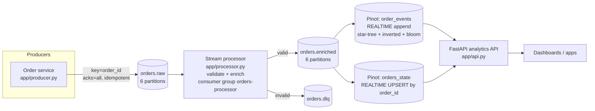

# 04 — Industry Project: Real-Time Order Analytics Platform

A miniature but realistic **e-commerce real-time analytics** platform: an order service emits lifecycle events to **Kafka**, a stream processor validates/enriches them, and **Apache Pinot** serves sub-second analytics (KPIs, funnels, revenue time-series, per-order drill-down) through a REST API — the same shape as production systems at Uber, LinkedIn, Stripe, Walmart.

Code: [`project/`](../project) · Prereqs: [03 — Installation](03-installation.md)

## 1. Requirements

**Functional**
* Ingest order events (`CREATED → PAID → SHIPPED → DELIVERED | CANCELLED`) at thousands/sec.
* Reject malformed events without blocking the pipeline (dead-letter topic).
* Enrich with product catalog (name, category, price → `amount`).
* Live KPIs: orders, revenue, cancellation count; revenue by category; funnel; revenue per minute; top products by city.
* Look up the *current* state and the *full history* of any order in milliseconds.

**Non-functional**
* Freshness < 2 s, p99 query latency < 100 ms, horizontally scalable, per-order ordering, no data loss (at-least-once) with idempotent results.

## 2. Architecture



### Design decisions (and why — great interview material)

| Decision | Rationale |
|---|---|
| Kafka key = `order_id` | Per-order ordering + all versions of an order land in one partition → **prerequisite for Pinot upsert**. |
| Two Pinot tables from one topic | `order_events` (append, history, funnels, star-tree aggregations) vs `orders_state` (upsert, latest state, point lookups). Different access patterns → different tables. |
| Enriched topic carries a **full snapshot** of the order | Required for `FULL` upsert (new row replaces old). |
| Processor = at-least-once with manual commit after flush | Simple & robust; duplicates are harmless in the upsert table (idempotent) and negligible in funnel counts. Exactly-once available via transactions ([example](../examples/kafka/03_transactions.py)). |
| DLQ instead of crash/skip | Poison pills must not stall a partition; DLQ keeps evidence for replay. |
| Idempotent producer, `acks=all`, lz4 | Durability + throughput. |
| Enrichment in a separate processor (not Pinot transform) | Reference data & validation logic stays testable; Pinot receives clean, typed data. (Pinot ingestion transforms are the alternative for simple derivations.) |
| Query inputs validated by whitelist/regex | Pinot's HTTP API has no bind parameters → prevents SQL injection. |
| Star-tree on `order_events` only | Pre-aggregation for dashboard queries; not applicable to upsert tables. |
| `event_time` as time column and upsert comparison column | Late/out-of-order events can't overwrite newer state. |

## 3. Repository layout

```text
project/
├── docker-compose.yml          # Kafka(KRaft) + Kafka UI + ZK + Pinot ctrl/broker/server + init jobs
├── requirements.txt
├── pytest.ini
├── pinot/
│   ├── order_events.schema.json / .table.json     # append table + star-tree + inverted/range/bloom
│   └── orders_state.schema.json / .table.json     # upsert table (FULL, comparison=event_time)
├── app/
│   ├── common.py        # config, catalog, validation, enrichment (pure functions)
│   ├── producer.py      # order simulator → orders.raw
│   ├── processor.py     # orders.raw → orders.enriched / orders.dlq
│   ├── queries.py       # validated SQL builders
│   └── api.py           # FastAPI on top of Pinot
└── tests/               # unit tests (no Kafka/Pinot needed)
```

## 4. Run it

```powershell
cd kafka-pinot-learning\project
docker compose up -d                      # wait for healthy (see 03-installation.md)
python -m venv .venv ; .\.venv\Scripts\Activate.ps1 ; pip install -r requirements.txt
pytest -q                                 # unit tests

# 3 terminals (venv activated, cwd = project/):
python -m app.producer --rate 50          # 50 new orders/s ≈ 150 events/s
python -m app.processor
uvicorn app.api:app --port 8000           # http://localhost:8000/docs
```

Try it:

```powershell
curl "http://localhost:8000/kpis?minutes=5"
curl "http://localhost:8000/revenue-by-category?minutes=15"
curl "http://localhost:8000/funnel?minutes=15"
curl "http://localhost:8000/revenue-timeseries?minutes=30"
curl "http://localhost:8000/top-products?minutes=60&limit=3&city=Pune"
curl "http://localhost:8000/orders/<order_id from Kafka UI or Pinot console>"
```

Explore: Pinot Query Console → `SELECT status, COUNT(*) FROM orders_state GROUP BY status` while the producer runs; watch the counts shift as orders progress (upsert in action) while `order_events` only grows (append).

## 5. Experiments (learn by breaking things)

| Experiment | What you learn |
|---|---|
| Stop the processor for 1 min, restart | Consumer lag grows (Kafka UI → Consumers), then drains; offsets resumed from commit. |
| Run **2–3 processors** | Rebalance; partitions split (max 6 useful). |
| Hard-kill the processor (`Stop-Process -Id <pid> -Force`) right after it produced but before it committed | On restart the batch is re-processed → duplicate `orders.enriched` messages → `orders_state` unaffected (idempotent), `order_events` may double-count that batch. Discuss Pinot **dedup**/transactions. |
| Send garbage: `docker exec -it kafka bash -c "echo 'k:not json' \| /opt/kafka/bin/kafka-console-producer.sh --bootstrap-server kafka:9092 --topic orders.raw --property parse.key=true --property key.separator=:"` | Lands in `orders.dlq` with the error. |
| Compare `COUNT(*)` of `order_events` and `orders_state` | Append vs upsert semantics. |
| Run the same group-by with and without `SET useStarTree=false;` after segments commit (lower `flush.threshold.rows` to force) | Compare `numDocsScanned` and `timeUsedMs`. |
| `docker compose stop pinot-server` for a minute, start again | Pinot resumes from stored offsets, catches up from Kafka without data loss. |
| `ALTER` partitions of `orders.raw` | See why partition count changes break key-colocation/upsert. |
| Load test: `--rate 500` | Observe lag, `timeUsedMs`, resource usage; tune `linger.ms`, `max.poll`, Pinot flush thresholds. |

## 6. Productionization checklist (what "industry level" means here)

**Kafka**
- [ ] ≥ 3 brokers across AZs, `replication.factor=3`, `min.insync.replicas=2`, `acks=all`, rack awareness.
- [ ] TLS + SASL/SCRAM or mTLS; ACLs per service; disable auto topic creation (already off).
- [ ] **Schema Registry + Avro/Protobuf** instead of JSON; compatibility = BACKWARD.
- [ ] Topic-as-code (Terraform / Strimzi `KafkaTopic` / GitOps); quotas; retention sized from `ingress × retention × RF`.
- [ ] Monitoring: lag, URP, offline partitions, request latency (Prometheus + Grafana, Burrow/Cruise Control).
- [ ] Retry topics + DLQ with replay tooling; idempotent consumers; consider Kafka Streams/Flink for stateful enrichment (joins with compacted product topic).
- [ ] Run processors as a Deployment with N replicas = partitions, graceful shutdown (SIGTERM, already handled), liveness/readiness probes.

**Pinot**
- [ ] Separate hosts for controller/broker/server/minion; 3 ZooKeepers; ≥ 2 replicas per segment; replica groups for QPS.
- [ ] Deep store on S3/GCS/ADLS; backups of ZK; segment size 100–500 MB; auto-tuned flush thresholds.
- [ ] Auth (Basic/OIDC) + TLS on controller/broker; table-level ACLs; query quotas per table.
- [ ] Capacity planning for upsert primary-key map memory; `snapshot` + `preload` for fast restarts; `metadataTTL` if keys expire.
- [ ] Minion `MergeRollupTask` / `RealtimeToOfflineSegmentsTask` for compaction & hybrid tables; tiering for old data.
- [ ] Observability: broker/server JMX → Prometheus, slow-query logging, alerts on `ingestion delay`, `consuming segment lag`, `query exceptions`.

**API / app**
- [ ] Authentication (OIDC/JWT), rate limiting, caching of hot queries, circuit breaker on Pinot calls, request timeouts (already `timeoutMs`).
- [ ] CI: unit tests (included), contract tests for Pinot configs, integration tests with Testcontainers, linting, image scanning.
- [ ] Containerize apps, deploy via Helm/Argo CD; secrets from a vault — **never in code** (bootstrap servers & endpoints come from env vars here).

## 7. Extending the project

1. Replace JSON with **Avro + Schema Registry** (add a `schema-registry` container; switch Pinot decoder to `KafkaConfluentSchemaRegistryAvroMessageDecoder`).
2. Add **Kafka Connect + Debezium** to stream a Postgres `customers` table, join in Flink/Kafka Streams for richer enrichment.
3. Add **Grafana** (Pinot data source plugin) or **Apache Superset** (`pinot://` SQLAlchemy URI) dashboards.
4. Add a **hybrid** offline table fed by the `RealtimeToOfflineSegmentsTask`.
5. Add **fraud / anomaly alerts**: Pinot query on a 1-minute window → alert on spike in `CANCELLED`.
6. Add **Prometheus + Grafana** for Kafka/Pinot JMX metrics.
7. Port the processor to **Kafka Streams (Java)** with `exactly_once_v2` and a KTable join to a compacted `products` topic.

## 8. How to talk about this project in an interview (60-second pitch)

> "I built a real-time order analytics platform. Orders events go to Kafka keyed by order id so per-order ordering is preserved. A processor validates and enriches events with at-least-once semantics, sending bad records to a DLQ. Apache Pinot ingests the enriched topic into two tables: an append-only table with a star-tree index for sub-100 ms dashboard aggregations, and an upsert table keyed by order id for latest-state lookups. A FastAPI layer serves KPIs with validated queries. I handled idempotency through upserts, partition-aware design, and I load-tested lag and query latency, tuning segment flush thresholds and indexes."

---
Prev: [03 — Installation](03-installation.md) · Next: [05 — Interview Questions](05-interview-questions.md)
