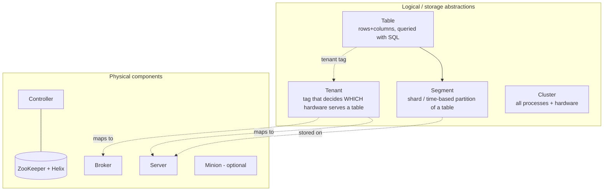
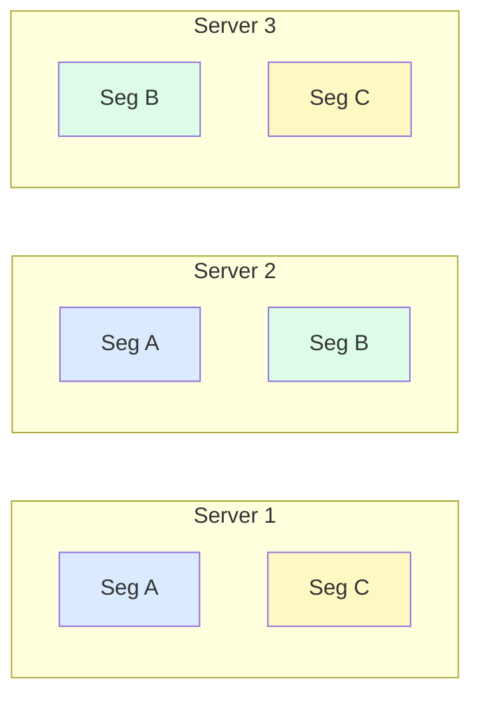
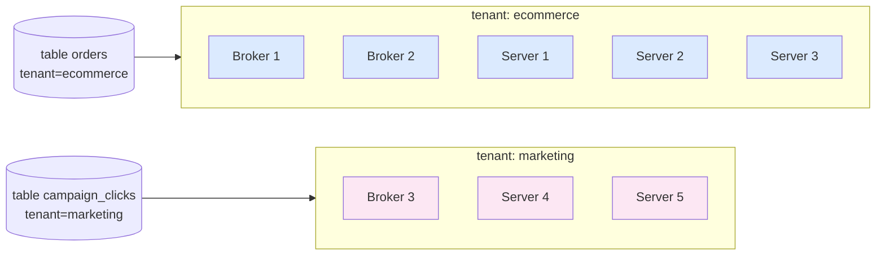
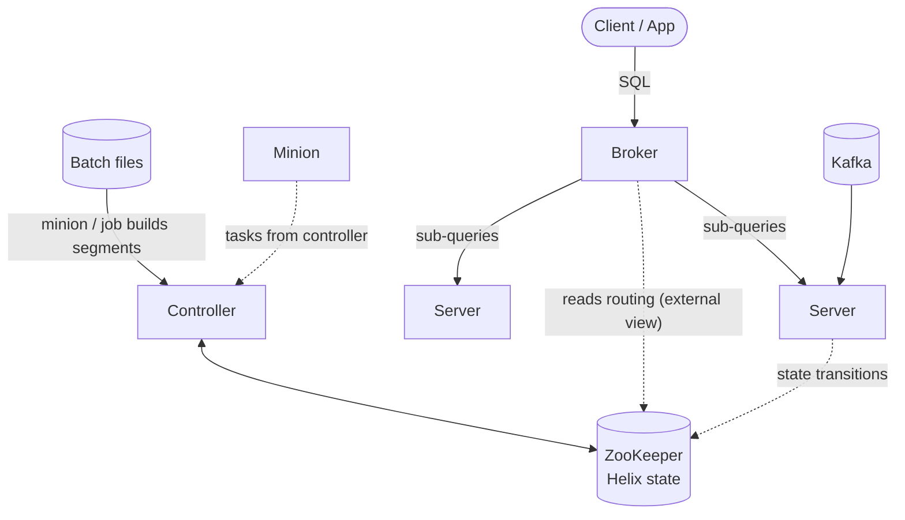
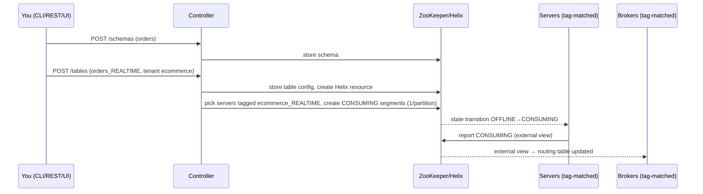

# 06 — Pinot Storage Model in Depth (Tables · Segments · Tenants · Cluster · Components)

A line-by-line walkthrough of the official page *"Pinot Storage Model"*, with a **single sample dataset** reused in every section so concepts connect. Read this after [02 — Pinot](02-pinot.md); it deepens the "Architecture", "Data model" and "Segments" sections.

## Contents
0. [The big picture](#0-the-big-picture)
1. [Sample data used everywhere](#1-sample-data-used-everywhere)
2. [Table](#2-table) — schema vs table, shared schema, real-time / offline / hybrid
3. [Segment](#3-segment) — splitting, columnar layout, dictionary + indexes, pruning, replicas
4. [Tenant](#4-tenant) — tags, isolation, example
5. [Cluster](#5-cluster)
6. [Physical architecture](#6-physical-architecture) — ZooKeeper, Helix, Controller, Server, Broker, Minion
7. [End-to-end walkthroughs](#7-end-to-end-walkthroughs) — create table, ingest, query, failure
8. [Mapping to our project](#8-mapping-to-our-project)
9. [Cheat-sheet and self-test](#9-cheat-sheet-and-self-test)

---

## 0. The big picture

The page names **four storage abstractions** (what your *data* looks like) and **five physical components** (what *runs*):



One-sentence summaries:

| Term | Think of it as… |
|---|---|
| **Table** | An RDBMS-like table (columns + rows) you query with SQL. |
| **Segment** | A shard of a table; "time-based partition". Unit of storage, replication and parallel compute. |
| **Tenant** | A *label* (text tag) stuck on both tables and machines; tables run only on machines with the same label. |
| **Cluster** | The whole deployment: controller + ZooKeeper + brokers + servers (+ minions). |
| **Controller** | The brain / orchestrator; REST API + UI. |
| **ZooKeeper (+Helix)** | The persistent, fault-tolerant memory of the cluster. |
| **Broker** | The query router: scatter → gather → merge. |
| **Server** | The data node: stores segments and computes on them. |
| **Minion** | Optional background worker for heavy non-query jobs (purge, merge, convert). |

> **Why "segments"?** The page says Pinot *"expects the size of a table to grow infinitely over time"*. A single node can't hold that, so data is cut into segments that spread over many servers (like shards in a sharded RDBMS), and each segment normally covers a time range.

---

## 1. Sample data used everywhere

Table **`orders`** — 12 rows over 3 days (amounts in ₹):

| row | order_id | city | status | amount | event_time (UTC date) |
|---|---|---|---|---|---|
| 1 | O1 | Pune | PAID | 799 | 2026-10-20 |
| 2 | O2 | Delhi | PAID | 3499 | 2026-10-20 |
| 3 | O3 | Pune | CANCELLED | 1899 | 2026-10-20 |
| 4 | O4 | Mumbai | PAID | 2999 | 2026-10-20 |
| 5 | O5 | Delhi | PAID | 899 | 2026-10-21 |
| 6 | O6 | Pune | PAID | 749 | 2026-10-21 |
| 7 | O7 | Mumbai | SHIPPED | 999 | 2026-10-21 |
| 8 | O8 | Delhi | PAID | 2499 | 2026-10-21 |
| 9 | O9 | Pune | PAID | 3499 | 2026-10-22 |
| 10 | O10 | Mumbai | PAID | 799 | 2026-10-22 |
| 11 | O11 | Pune | DELIVERED | 1899 | 2026-10-22 |
| 12 | O12 | Delhi | PAID | 2999 | 2026-10-22 |

(In real life `event_time` is epoch milliseconds, e.g. `1792454400000`; dates are used here for readability.)

---

## 2. Table

### 2.1 What the page says
* A table is *"a logical abstraction to refer to a collection of related data"* with columns and rows (called **documents**), queried with SQL.
* Every table is associated with a **schema** (column names + data types).
* Unlike an RDBMS, **multiple Pinot tables can inherit one schema definition**, and each table is independently configured for *indexing, partitioning, tenants, data sources, replication*.

### 2.2 Schema = "what the columns are"

```json
{
  "schemaName": "orders",
  "dimensionFieldSpecs": [
    {"name": "order_id", "dataType": "STRING"},
    {"name": "city",     "dataType": "STRING"},
    {"name": "status",   "dataType": "STRING"}
  ],
  "metricFieldSpecs":   [{"name": "amount", "dataType": "DOUBLE"}],
  "dateTimeFieldSpecs": [{"name": "event_time", "dataType": "LONG",
                          "format": "1:MILLISECONDS:EPOCH", "granularity": "1:MILLISECONDS"}]
}
```
The schema lives in its own JSON file — that is exactly *why* it can be shared.

### 2.3 Table config = "how this copy of the data is ingested, stored, indexed and served"

Two tables, **one schema**, very different behaviour:

```jsonc
// orders_REALTIME  — fed by Kafka, optimised for freshness
{ "tableName": "orders", "tableType": "REALTIME",
  "segmentsConfig": { "timeColumnName": "event_time", "schemaName": "orders",
                      "replication": "2", "retentionTimeUnit": "DAYS", "retentionTimeValue": "3" },
  "tenants": { "broker": "ecommerce", "server": "ecommerce" },
  "tableIndexConfig": { "invertedIndexColumns": ["status"] },
  "ingestionConfig": { "streamIngestionConfig": { "streamConfigMaps": [ { "streamType": "kafka", "...": "..." } ] } } }

// orders_OFFLINE   — fed by nightly batch jobs, optimised for cheap history & fast scans
{ "tableName": "orders", "tableType": "OFFLINE",
  "segmentsConfig": { "timeColumnName": "event_time", "schemaName": "orders",
                      "replication": "3", "retentionTimeUnit": "DAYS", "retentionTimeValue": "365" },
  "tenants": { "broker": "ecommerce", "server": "ecommerce" },
  "tableIndexConfig": { "invertedIndexColumns": ["status", "city"],
                        "starTreeIndexConfigs": [ { "dimensionsSplitOrder": ["city","status"],
                                                    "functionColumnPairs": ["SUM__amount","COUNT__*"] } ] } }
```

| Concern | `orders_REALTIME` | `orders_OFFLINE` |
|---|---|---|
| Data source | Kafka topic | Files (Parquet/Avro/CSV) via batch job |
| Replication | 2 | 3 |
| Retention | 3 days | 365 days |
| Indexes | inverted on `status` | inverted + star-tree |
| Same schema? | ✅ `orders` | ✅ `orders` |

You can also create an unrelated table, e.g. `orders_eu`, with `"schemaName": "orders"` — a third table that re-uses the same column definitions but its own tenant, indexes and source.

### 2.4 The three table types

| Type | Loads data from | Typical use |
|---|---|---|
| **real-time** | A stream (Kafka, Kinesis, Pulsar) | Fresh data, seconds old |
| **offline** | A batch source (files in S3/HDFS/…) | Historical, back-filled, curated data |
| **hybrid** | Both: one *real-time* + one *offline* table **with the same name** | Fresh data from stream + cleaned history from batch |

#### Hybrid example with the sample data
* Nightly batch job loaded days **10-20 and 10-21** into `orders_OFFLINE` → its max time is end of **2026-10-21** (the *time boundary*).
* Kafka is currently delivering **10-22** rows into `orders_REALTIME` (it may still hold older rows, e.g. 10-21 events, that were already consumed).

Query: `SELECT SUM(amount) FROM orders WHERE status = 'PAID'`

The broker **rewrites it into two queries** and merges the results:

```text
offline  part:  ... WHERE status = 'PAID' AND event_time <= 2026-10-21 23:59:59   → rows 1,2,4,5,6,8
realtime part:  ... WHERE status = 'PAID' AND event_time >  2026-10-21 23:59:59   → rows 9,10,12
```
`799+3499+2999+899+749+2499 = 11444` (offline) `+ 3499+799+2999 = 7297` (realtime) → **18741**. No row is counted twice because the time boundary splits the time axis cleanly. When the nightly job later pushes 10-22 into offline, the boundary moves and the real-time table's copy of that day is simply ignored by queries until retention deletes it.

---

## 3. Segment

### 3.1 What the page says
* Tables are stored as **one or more independent shards called segments**. A small table may be a single segment; tables can have **unlimited** segments.
* Segments are **time-based partitions** of table data, **stored on servers**, which scale horizontally for both **storage and computation**.
* Segments are created by different processes (stream ingestion, batch jobs, minion tasks).

### 3.2 Our 12 rows as segments (offline table, one segment per day)

```text
orders_OFFLINE
├── Segment A  (2026-10-20)  rows 1-4    min_time=10-20  max_time=10-20  docs=4
├── Segment B  (2026-10-21)  rows 5-8    min_time=10-21  max_time=10-21  docs=4
└── Segment C  (2026-10-22)  rows 9-12   min_time=10-22  max_time=10-22  docs=4
```
Every segment is **self-contained**: data + dictionaries + indexes + metadata. It can be loaded, moved, replaced, or deleted on its own — the foundation for rebalancing, backfills and retention ("delete segments whose max_time is older than 365 days").

### 3.3 Inside a segment: columnar storage

A relational DB stores *rows* together. Pinot stores each *column* separately:

```text
Segment C (rows 9-12), docIds 0..3
              docId:   0        1        2          3
order_id          :   O9       O10      O11        O12
city              :   Pune     Mumbai   Pune       Delhi
status            :   PAID     PAID     DELIVERED  PAID
amount            :   3499     799      1899       2999
```

**Dictionary encoding** (default for dimensions): sorted unique values → ids.

| Column | Dictionary (value → id) | Forward index (docId → id) |
|---|---|---|
| `city` | Delhi=0, Mumbai=1, Pune=2 | `[2, 1, 2, 0]` |
| `status` | DELIVERED=0, PAID=1 | `[1, 1, 0, 1]` |

**Inverted index** (optional): value → list of docIds.

| `city` inverted | docIds | `status` inverted | docIds |
|---|---|---|---|
| Delhi | `[3]` | DELIVERED | `[2]` |
| Mumbai | `[1]` | PAID | `[0, 1, 3]` |
| Pune | `[0, 2]` | | |

**Query inside the segment**: `WHERE status = 'PAID' AND city = 'Pune'`
1. Look up `PAID` → docIds `[0,1,3]`; look up `Pune` → `[0,2]`.
2. Intersect → `[0]`.
3. Read `amount` only for docId 0 → **3499**. The `order_id` and other columns are never touched — that is why columnar + indexes are fast for analytics.

**On disk** (segment format v3) a segment directory contains roughly: `columns.psf` (all column data & index buffers in one file), `index_map` (where each buffer lives), `metadata.properties` (name, doc count, start/end time, CRC, per-column stats), `creation.meta`. Segment files are memory-mapped by the server.

### 3.4 Segment pruning with the sample data

Query: `SELECT city, SUM(amount) FROM orders WHERE event_time >= '2026-10-21' AND status = 'PAID' GROUP BY city`

| Segment | Metadata time range | Decision |
|---|---|---|
| A | 10-20 → 10-20 | ❌ **pruned** (can't contain rows ≥ 10-21) — never read |
| B | 10-21 → 10-21 | ✅ scan: PAID rows = O5 Delhi 899, O6 Pune 749, O8 Delhi 2499 |
| C | 10-22 → 10-22 | ✅ scan: PAID rows = O9 Pune 3499, O10 Mumbai 799, O12 Delhi 2999 |

Partial results are merged: Delhi = 899+2499+2999 = **6397**, Pune = 749+3499 = **4248**, Mumbai = **799**.
Because segments are *time-based*, a time filter lets Pinot skip whole shards — the reason you should always filter on the time column.

### 3.5 Segments on servers, with replication

Assume 3 servers and `replication = 2`. The controller assigns each segment to 2 servers:


* Storage scales: more servers → each holds fewer segments.
* Compute scales: segments B and C can be scanned **in parallel** on different servers.
* Availability: lose Server 3 → B still on S2, C still on S1 → queries keep working.

### 3.6 Real-time table segments (what is different)

For a stream, segments are created *continuously*:

| State | What it is |
|---|---|
| **CONSUMING** | Mutable, in-memory segment filling from one Kafka partition; already queryable. |
| **ONLINE (completed)** | Immutable columnar segment after the flush threshold (rows/time/size) is hit; uploaded to deep store. |

Naming: `orders__<kafkaPartition>__<sequence>__<creationTime>`, e.g. `orders__0__0__20261022T0500Z` (completed) then `orders__0__1__20261022T0612Z` (consuming). A table consuming a 6-partition topic has **6 consuming segments at any moment** (per replica).

---

## 4. Tenant

### 4.1 What the page says
* A **tenant** is a *"logical namespace"*: a **text tag**.
* Both **tables** and **hardware** (brokers and servers) carry tags. *"Tables of a particular tenant tag will only be scheduled for storage and query processing on hardware that belongs to the same tenant tag."*
* Default for everything: **`DefaultTenant`**.
* Benefits: teams/apps get isolated namespaces without separate Pinot deployments; noisy workloads can't hurt others; operators assign workloads to specific hardware.

### 4.2 Example cluster



| Instance | Tags |
|---|---|
| Broker 1, 2 | `ecommerce_BROKER` |
| Server 1–3 | `ecommerce_OFFLINE`, `ecommerce_REALTIME` |
| Broker 3 | `marketing_BROKER` |
| Server 4–5 | `marketing_OFFLINE`, `marketing_REALTIME` |
| *(untouched defaults)* | `DefaultTenant_BROKER`, `DefaultTenant_OFFLINE`, `DefaultTenant_REALTIME` |

Table config selects the tenant:

```json
"tenants": { "broker": "ecommerce", "server": "ecommerce" }
```
Result: queries on `orders` go **only** to ecommerce brokers; its segments are stored **only** on servers 1–3. A heavy `campaign_clicks` scan on marketing servers cannot slow `orders`.

Advanced: split real-time ingestion hardware from completed-segment hardware with `tagOverrideConfig`:

```json
"tenants": { "broker": "ecommerce", "server": "ecommerce",
             "tagOverrideConfig": { "realtimeConsuming": "ecommerce_REALTIME",
                                    "realtimeCompleted": "ecommerce_OFFLINE" } }
```
(consuming segments live on ingest-optimised servers, then move to storage-optimised servers once completed).

Create a tenant with the controller REST API (`POST /tenants`, see Swagger at `:9000/help`), e.g. `{"role":"SERVER","tenantName":"ecommerce","offlineInstances":2,"realtimeInstances":1}`.

> Caveat worth knowing: tenants isolate *where data lives and which brokers/servers handle queries* — they are an operational partition, not a security/authorization boundary (use Pinot access control for that).

---

## 5. Cluster

A **cluster** = all software processes + hardware needed to ingest, store and query data. Smallest useful cluster = **1 controller + 1 ZooKeeper + 1 broker + 1 server** (our `docker-compose.yml` runs exactly this). Production: processes on separate machines; clusters range from <10 to >1,000 instances. Many tenants can share one cluster.

---

## 6. Physical architecture



### 6.1 ZooKeeper
Fault-tolerant, persistent store for: **table configs, schemas, segment metadata, cluster state**. Nothing is "owned" by the controller process itself — if the controller restarts it re-reads ZooKeeper. Production = 3 or 5 node ensemble.

Rough layout: `/<cluster>/PROPERTYSTORE/CONFIGS/TABLE/orders_OFFLINE`, `.../SCHEMAS/orders`, `.../SEGMENTS/orders_OFFLINE/<segment>` + Helix's `IDEALSTATES`, `EXTERNALVIEW`, `LIVEINSTANCES`.

### 6.2 Helix (cluster manager embedded in Pinot)
Created by Pinot's authors; Pinot uses it for cluster management. Concepts:

| Helix term | Pinot meaning |
|---|---|
| **Resource** | A table (`orders_OFFLINE`) |
| **Partition** | A segment |
| **Replica** | A copy of a segment on a server |
| **State** | `ONLINE`, `OFFLINE`, `CONSUMING`, `DROPPED`, `ERROR` |
| **Ideal state** | *Desired* mapping segment → server → state (stored in ZK) |
| **External view** | *Actual* state reported by servers |
| **Participants** | Servers, Brokers, Minions (they *do* the work and report state) |
| **Spectator** | Brokers also *watch* the external view to build routing tables |
| **Controller** | Compares ideal vs external view and sends state-transition messages to fix differences |

Example for our hybrid table:

```text
IDEAL STATE  orders_OFFLINE         EXTERNAL VIEW  orders_OFFLINE
 A: {S1: ONLINE, S2: ONLINE}         A: {S1: ONLINE, S2: ONLINE}
 B: {S2: ONLINE, S3: ONLINE}         B: {S2: ONLINE, S3: OFFLINE}   ← S3 down
 C: {S3: ONLINE, S1: ONLINE}         C: {S3: OFFLINE, S1: ONLINE}
```
Broker reads the external view → routes B to S2 and C to S1 only. The gap between ideal and external view is how you spot problems (segments in `ERROR`/`OFFLINE`).

### 6.3 Controller
Core orchestrator for **consistency and routing**; horizontally scalable, deployed as one process or several in active/passive (one leader). It:
* hosts the **REST API** (admin: create schema/table, upload segments, rebalance, reload) and the **web UI/Query Console** (`:9000`);
* reacts to metadata changes or node failures and **(re)schedules resources**: assigns segments to servers, triggers state transitions;
* coordinates **ingestion**: for real-time tables it creates consuming segments and runs the segment-commit protocol; for offline tables it accepts segment uploads and assigns them;
* runs periodic tasks (retention, segment validation, minion task scheduling).

Example: you `POST` a new segment D for 2026-10-23 → controller stores metadata in ZK → picks 2 servers (e.g. S1, S2) honouring tenant tags & replication → updates ideal state → servers download D from deep store → report `ONLINE` → brokers start routing to it.

### 6.4 Server
*"Provides storage for segment files and compute for query processing."* Notified by Helix about state changes; scale horizontally.
* **Offline server role** – hosts immutable, batch-loaded segments (CPU: query only).
* **Real-time server role** – continuously **consumes** from Kafka, builds consuming segments, flushes/commits them, *and* serves queries (CPU/memory heavy). Hence the advice to isolate hardware (see `tagOverrideConfig` in §4) so high-throughput ingestion is prioritised without hurting historical queries (or vice-versa).

What a server does for a query: receives (segmentList, query) from the broker → runs filter/aggregation per segment in parallel threads using indexes → combines segments' results on that server → returns **one partial result**.

### 6.5 Broker
Accepts SQL from clients, **scatters** to the *minimal subset of servers* that hold relevant segments (it knows the cluster metadata from the controller/ZK), **gathers** partial results, merges (final group-by, order-by, limit) and responds. When shuffling is needed (multi-stage engine for joins), other servers help consolidate. *More brokers ⇒ more concurrent queries and lower latency.*

Worked query (replication=2 layout from §3.5):

```text
SELECT city, SUM(amount) FROM orders WHERE event_time >= '2026-10-21' AND status='PAID' GROUP BY city

1. Parse + validate against schema.
2. Prune: segment A excluded (time).
3. Routing: B → Server 2 ; C → Server 3 (one replica per segment, load-balanced).
4. Scatter:
     Server 2 (B) partial: Delhi=3398, Pune=749
     Server 3 (C) partial: Pune=3499, Mumbai=799, Delhi=2999
5. Gather + merge: Delhi=6397, Pune=4248, Mumbai=799
6. Return rows + stats (numSegmentsQueried=2, numDocsScanned=6, timeUsedMs=…)
```

### 6.6 Minion (optional)
Runs **background tasks outside the query path** so servers' query latency isn't degraded. Tasks are scheduled/directed by the **controller**; they can run once or periodically.

Typical tasks:
| Task | Example |
|---|---|
| **Segment generation & push** | Convert a day's Avro/JSON files into segment files for the offline table. |
| **Purge (GDPR)** | Pinot segments are *immutable*, so deleting a user's rows = **rewrite** the segment without them. |
| **Merge/Rollup** | Merge many small segments into bigger ones; roll up to coarser time grain. |
| **RealtimeToOffline** | Convert completed real-time segments into offline segments (hybrid automation). |
| **Custom** | Your own periodic task. |

GDPR example: user "Delhi / O5" requests deletion. Minion downloads Segment B, writes a new Segment B′ with rows 6,7,8 only (3 docs), rebuilds dictionaries and indexes, uploads it replacing B; servers swap atomically. Enabling a purge schedule in the table config (plus a registered record purger in the minion):

```json
"task": { "taskTypeConfigsMap": { "PurgeTask": { "schedule": "0 0 2 * * ? *" } } }
```
A cluster works fine without minions; most production clusters have them for routine batch ingest and compaction.

---

## 7. End-to-end walkthroughs

### 7.1 Create schema + table


### 7.2 Real-time row → query
1. Producer writes order `O13, Pune, PAID, 1299` to Kafka partition 3.
2. The server owning consuming segment `orders__3__7__…` reads it; row is appended in memory and **instantly queryable**.
3. Segment reaches the threshold → server builds immutable columnar files + indexes → uploads to deep store → controller marks `ONLINE` → new consuming segment `orders__3__8__…` starts.
4. Any query now hits the completed segment (fast, mmap, indexed) + the new consuming one.

### 7.3 Failure scenarios
| Event | What happens |
|---|---|
| **Server dies** (replication ≥ 2) | Helix marks it offline; external view drops its replicas; brokers re-route to surviving replicas; no downtime. Add/replace a server → run **rebalance** to restore replica count. |
| **Server dies** (replication = 1) | Its segments are unavailable (partial/failed results) until it returns or segments are reloaded from deep store onto another server. |
| **Broker dies** | Clients use another broker (put brokers behind a load balancer). Stateless. |
| **Controller dies** | Queries and ingestion on servers continue; admin operations & segment commits pause until a standby takes over (active/passive). |
| **ZooKeeper loses quorum** | Existing queries continue briefly on cached routing; no metadata changes/commits. Keep 3–5 nodes. |
| **Minion dies** | Background tasks are retried; no query impact. |

---

## 8. Mapping to our project

Files: [`project/pinot/`](../project/pinot) and [`project/docker-compose.yml`](../project/docker-compose.yml)

| Storage-model concept | In our project |
|---|---|
| Schemas | `order_events.schema.json`, `orders_state.schema.json` (two different schemas; the same schema *could* back several tables) |
| Tables | `order_events_REALTIME` (append) and `orders_state_REALTIME` (upsert); both real-time, both fed by `orders.enriched` |
| Segments | One CONSUMING segment per Kafka partition (6) per table; completed when 20 000 rows or 15 min is reached |
| Tenant | `"tenants": {"broker":"DefaultTenant","server":"DefaultTenant"}` — the default for everything |
| Cluster | ZooKeeper + controller + broker + server containers |
| Minion | Not deployed (optional) — add it to try `MergeRollupTask` / purge |

Try it (after `docker compose up -d` and the producer/processor are running):

```text
GET http://localhost:9000/segments/order_events          → list segments & states
GET http://localhost:9000/tables/order_events/size       → storage size
GET http://localhost:9000/tables/order_events/idealstate → desired state
GET http://localhost:9000/tables/order_events/externalview → actual state
```
and in the UI: **Cluster Manager → Tables → `order_events_REALTIME` → Segments** (look for `CONSUMING` vs `ONLINE`) and **Zookeeper Browser** to see the metadata.

---

## 9. Cheat-sheet and self-test

**Remember**
* Table ≈ RDBMS table; **schema is separate and shareable**; real-time / offline / hybrid.
* Segment = shard/time partition; self-contained, columnar, immutable once completed; unit of replication & pruning.
* Tenant = tag on tables **and** machines; default `DefaultTenant`.
* Cluster minimum = controller + ZooKeeper + broker + server; minion optional.
* Controller orchestrates · ZK stores · Helix drives state · Broker routes · Server stores+computes · Minion does background jobs.

**Self-test**
1. Why can two tables share one schema, and what can differ between them? *(Schema is a separate JSON; table config differs in indexes, partitioning, tenants, sources, replication.)*
2. In the hybrid example, why is no row double-counted? *(Time boundary splits the query.)*
3. Which segment is pruned for `event_time >= 10-21`? Why? *(A — max_time 10-20 from segment metadata.)*
4. A server tagged `marketing_OFFLINE` — can it host `orders` segments (tenant `ecommerce`)? *(No.)*
5. Why is deleting one user's row handled by Minion? *(Immutable segments → rewrite the segment off the query path.)*
6. What do brokers read to know where segments live? *(Routing built from Helix external view / ZK metadata.)*
7. What happens to queries when one of two replicas' servers dies? *(Broker re-routes to the other replica.)*

---
Prev: [05 — Interview Questions](05-interview-questions.md) · Back to [README](../README.md)
